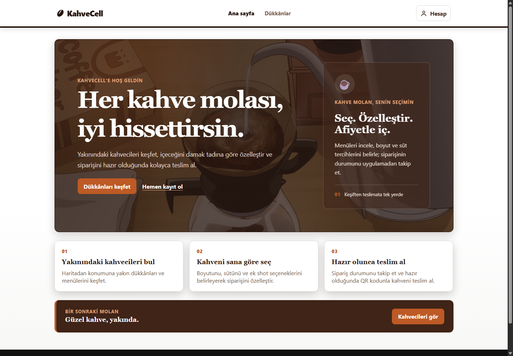
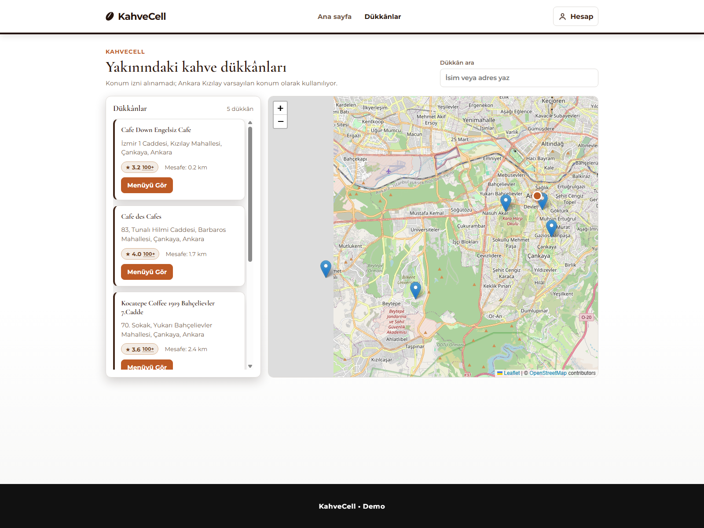

# KahveCell

KahveCell, kahve dükkânlarını keşfetme, içecekleri kişiselleştirerek sipariş verme ve siparişi QR koduyla teslim alma akışlarını bir araya getiren örnek bir web uygulamasıdır.

## Ekran görüntüleri

| Ana sayfa | Dükkânlar |
| --- | --- |
|  |  |

| Dükkân menüsü |
| --- |
|  |

## Özellikler

- Müşteri, dükkân sahibi ve yönetici rolleri
- Dükkân listesi, harita, arama ve konum bazlı sıralama
- Dükkân menüsü, ürün fiyatları ve içecek özelleştirmeleri
- Sipariş geçmişi, favori siparişler ve dükkân puanları
- Sipariş durumlarının SSE ile gerçek zamanlı güncellenmesi
- QR koduyla sipariş teslimi
- Dükkân çalışma saatleri ve ürün yönetimi
- Abonelik, kahve hakları ve merkezi yönetim ekranı

## Teknolojiler

- **Backend:** Python, FastAPI, SQLAlchemy
- **Veritabanı:** SQLite
- **Frontend:** React, TypeScript, Vite
- **Harita:** Leaflet
- **Gerçek zamanlı bildirim:** Server-Sent Events (SSE)

## Gereksinimler

- Python 3.11 veya üzeri
- Node.js 20.19+ veya 22.12+
- npm

## Yerel kurulum

### 1. Backend

Windows PowerShell:

```powershell
cd backend
py -3 -m venv .venv
.\.venv\Scripts\Activate.ps1
python -m pip install --upgrade pip
pip install -r requirements.txt
python seed_data.py
python -m uvicorn app.main:app --reload
```

macOS / Linux:

```bash
cd backend
python3 -m venv .venv
source .venv/bin/activate
python -m pip install --upgrade pip
pip install -r requirements.txt
python seed_data.py
python -m uvicorn app.main:app --reload
```

Backend varsayılan olarak `http://localhost:8000` adresinde çalışır. API belgeleri `http://localhost:8000/docs` adresindedir. Veritabanı ve JWT anahtarı ilk çalıştırmada yerel olarak oluşturulur; bu dosyalar Git'e eklenmemelidir.

`seed_data.py`, yalnızca geliştirme ortamında demo dükkânları, menüleri, kullanıcıları ve puanları ekler; çalıştırma sırasında demo giriş bilgilerini terminale yazar. `reviewer001`–`reviewer100` puan örnekleridir ve giriş parolaları yoktur. Demo hesaplarını veya parolalarını gerçek kullanımda kullanmayın.

### 2. Frontend

Yeni bir terminal açıp:

Windows PowerShell:

```powershell
cd frontend
Copy-Item .env.example .env.local
npm install
npm run dev
```

macOS / Linux:

```bash
cd frontend
cp .env.example .env.local
npm install
npm run dev
```

Vite geliştirme sunucusunun yazdırdığı yerel adresi tarayıcıda açın. API adresi `frontend/.env.local` içindeki `VITE_API_BASE_URL` ile değiştirilebilir.

## Test ve kalite kontrolleri

Backend testleri:

```powershell
cd backend
.\.venv\Scripts\python.exe -m unittest discover -s tests -v
```

Frontend:

```bash
cd frontend
npm run lint
npm run build
```

## Güvenlik ve veri

- Yerel SQLite veritabanı, `.env` dosyaları ve JWT anahtarı `.gitignore` tarafından dışarıda bırakılır.
- Demo veri üretimi yalnızca geliştirme ortamında kullanılmalıdır.
- Bu uygulama eğitim/demo amaçlıdır; ödeme akışı gerçek kart işlemi yapmaz.
