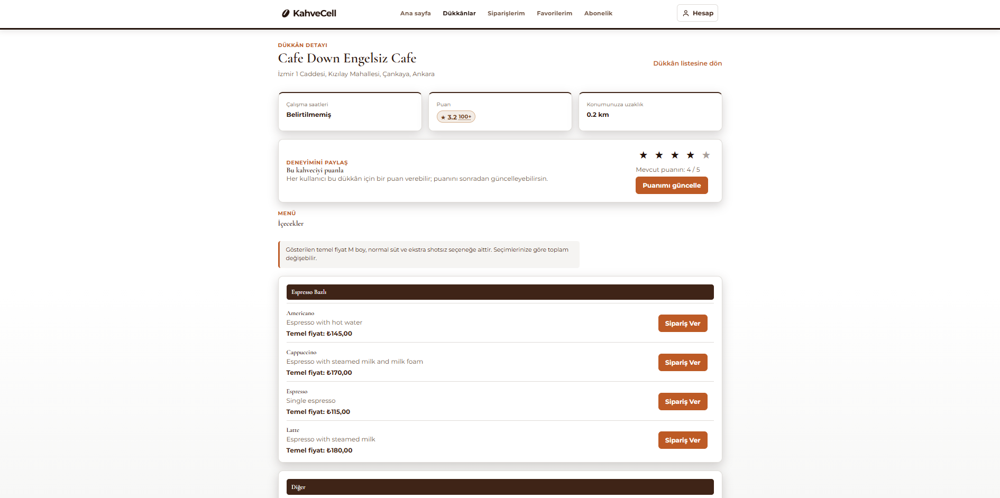
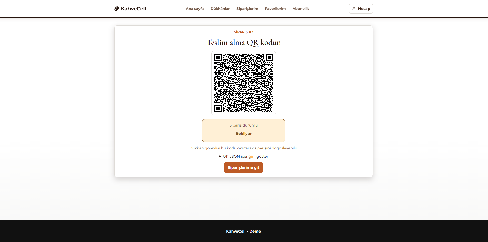
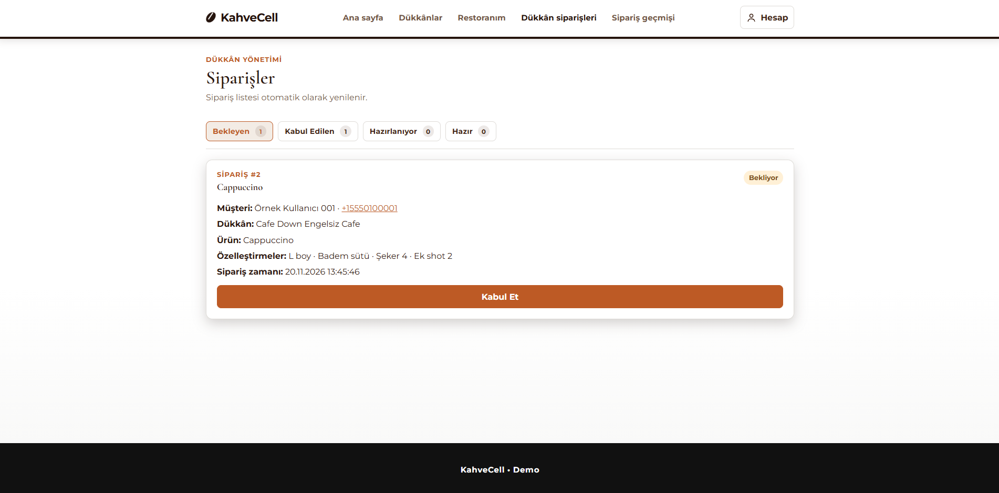
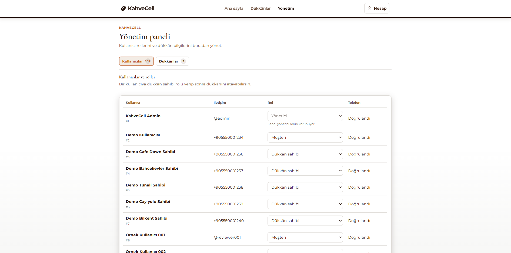

Her kahve molasında yeni bir keşif.

[](https://www.python.org/)
[](https://fastapi.tiangolo.com/)
[](https://react.dev/)
[](https://www.typescriptlang.org/)
[](https://vite.dev/)

# KahveCell

KahveCell; kahve dükkânlarını keşfetme, içecekleri kişiselleştirerek sipariş verme ve siparişi QR koduyla teslim alma akışlarını bir araya getiren örnek bir web uygulamasıdır.

## Proje hakkında

KahveCell, benim ürün fikrim ve yönlendirmemle yapay zekâ destekli vibe coding süreci kullanılarak oluşturuldu. Uygulamanın kodlarını tek başıma yazmadım; projeyi yapay zekâ ile birlikte adım adım geliştirdim.

## Ekran görüntüleri

| Ana sayfa | Dükkânlar |
| --- | --- |
|  |  |

| Dükkân menüsü | QR ekranı |
| --- | --- |
|  |  |

| Dükkân sahibi paneli | Yönetici ekranı |
| --- | --- |
|  |  |

## Özellikler

- Müşteri, dükkân sahibi ve yönetici rolleri
- Dükkân listesi, harita, arama ve konum bazlı sıralama
- Dükkân menüsü, ürün fiyatları ve içecek özelleştirmeleri
- Sipariş geçmişi, favori siparişler ve dükkân puanları
- Sipariş durumlarının SSE ile gerçek zamanlı güncellenmesi
- QR koduyla sipariş teslimi
- Dükkân çalışma saatleri ve ürün yönetimi
- Abonelik, kahve hakları ve merkezi yönetim ekranı

## Nasıl çalışır?

1. Müşteri bir abonelik alır.
2. Haritadan bir dükkân seçer.
3. İçeceğini özelleştirip sipariş verir. Her siparişte 1 kahve hakkı düşer.
4. Dükkân sipariş durumunu `PENDING` → `ACCEPTED` → `PREPARING` → `READY` sırasıyla ilerletir.
5. Müşteri QR kodunu gösterir. Dükkân kodu okuttuğunda sipariş `DELIVERED` olur.
6. Müşteri sipariş durumunu SSE üzerinden canlı görür.

## Roller

- `CUSTOMER`: Dükkânları keşfeder, abonelik alır, sipariş verir ve siparişlerini puanlar.
- `SHOP_OWNER`: Menüyü ve çalışma saatlerini düzenler, dükkân siparişlerini yönetir ve QR kodunu okutarak teslimi tamamlar.
- `ADMIN`: Kullanıcıları, dükkânları ve uygulamanın merkezi yönetim ekranlarını kontrol eder.

## Abonelik paketleri

| Paket | Aylık fiyat | Haklar |
| --- | ---: | --- |
| Starter | 89,99 TL | 10 kahve |
| Premium | 149,99 TL | 20 kahve + 2 misafir hakkı |
| Unlimited | 249,99 TL | Sınırsız kahve + 5 misafir hakkı + öncelikli teslim |

## Teknolojiler

- **Backend:** Python, FastAPI, SQLAlchemy
- **Veritabanı:** SQLite
- **Frontend:** React, TypeScript, Vite
- **Harita:** Leaflet
- **Gerçek zamanlı bildirim:** Server-Sent Events (SSE)

## Mimari

```text
backend/
└── app/
    ├── api/v1/       # API router'ları
    ├── services/     # İş mantığı
    ├── models/       # Veritabanı modelleri
    ├── schemas/      # API veri şemaları
    ├── core/         # Güvenlik, roller ve QR imzası
    └── db/           # Veritabanı bağlantısı ve başlatma

frontend/
└── src/
    ├── pages/        # Sayfalar
    ├── components/   # Arayüz bileşenleri
    ├── lib/          # API ve yardımcı araçlar
    └── app/          # Uygulama kurulumu ve yönlendirme
```

## Teknik öne çıkanlar

- JWT kimlik doğrulaması ve 600.000 iterasyonlu PBKDF2-SHA256 parola özeti
- HMAC-SHA256 ile imzalanan QR kodları
- Tek kullanımlık QR kodu için atomik `UPDATE`; yarış durumu olmadan kahve hakkı düşürme
- Fiyat hesabının sunucu tarafında `Decimal` ile yapılması
- SSE ile canlı sipariş durumu
- İzin verilen sıralı geçişleri uygulayan sipariş durum makinesi

## Gereksinimler

- Python 3.11 veya üzeri
- Node.js 20.19+ veya 22.12+
- npm

## Yerel kurulum

### 1. Backend

Windows PowerShell:

```powershell
cd backend
py -3 -m venv .venv
.\.venv\Scripts\Activate.ps1
python -m pip install --upgrade pip
pip install -r requirements.txt
python seed_data.py
python -m uvicorn app.main:app --reload
```

macOS / Linux:

```bash
cd backend
python3 -m venv .venv
source .venv/bin/activate
python -m pip install --upgrade pip
pip install -r requirements.txt
python seed_data.py
python -m uvicorn app.main:app --reload
```

Backend varsayılan olarak `http://localhost:8000` adresinde çalışır. API belgeleri `http://localhost:8000/docs` adresindedir.

### 2. Frontend

Yeni bir terminal açın.

Windows PowerShell:

```powershell
cd frontend
Copy-Item .env.example .env.local
npm install
npm run dev
```

macOS / Linux:

```bash
cd frontend
cp .env.example .env.local
npm install
npm run dev
```

Vite geliştirme sunucusunun yazdırdığı yerel adresi tarayıcıda açın.

## Ortam değişkenleri

| Değişken | Açıklama |
| --- | --- |
| `KAHVECELL_JWT_SECRET` | En az 32 karakter olmalıdır. Ayarlanmazsa ilk çalıştırmada `.jwt_secret` dosyası üretilir. |
| `KAHVECELL_ENV` | Çalışma ortamı. Varsayılan değer `development` olur. |
| `KAHVECELL_ADMIN_USERNAME` | Üretim ortamında admin kullanıcı adı. |
| `KAHVECELL_ADMIN_PASSWORD` | `development` dışında zorunludur ve en az 12 karakter olmalıdır. |
| `VITE_API_BASE_URL` | Frontend'in kullanacağı API adresi. `frontend/.env.local` dosyasında ayarlanır. |

## Demo girişleri

`development` ortamında varsayılan admin hesabı `admin` / `admin` şeklindedir. Demo müşteri ve dükkân sahibi hesaplarının giriş bilgileri `backend/seed_data.py` çalıştırıldığında terminale yazdırılır. Bu hesaplar ve parolalar yalnızca geliştirme içindir; gerçek kullanımda kullanmayın.

## Test ve kalite kontrolleri

Backend testleri — Windows PowerShell:

```powershell
cd backend
.\.venv\Scripts\python.exe -m unittest discover -s tests -v
```

Backend testleri — macOS / Linux:

```bash
cd backend && source .venv/bin/activate && python -m unittest discover -s tests -v
```

Frontend:

```bash
cd frontend
npm run lint
npm run build
```

## Güvenlik ve veri

- Yerel SQLite veritabanı, `.env` dosyaları ve JWT anahtarı `.gitignore` tarafından dışarıda bırakılır.
- Demo veri üretimi yalnızca geliştirme ortamında kullanılmalıdır.
- Uygulama eğitim ve demo amaçlıdır. Ödeme akışı gerçek kart işlemi yapmaz.

## Bilinen sınırlamalar

- OTP bir simülasyondur; doğrulama kodu her zaman `1234` olur.
- Ödeme gerçek değildir. Yalnızca test kartları kullanılır: `4242424242424242` başarılı, `4000000000000002` reddedilir.
- SSE yayıncısı bellek içindedir; uygulama tek süreçte çalışır.
- SQLite yalnızca demo içindir.
- Giriş denemeleri için hız sınırı yoktur.

## Yol haritası

- Gerçek SMS OTP
- Rate limiting
- PostgreSQL ve Alembic
- Redis ile SSE
- Gerçek ödeme sağlayıcısı
- Docker Compose
- GitHub Actions CI

## Lisans

Bu depo şu anda özel bir lisans dosyası içermemektedir; eğitim ve deneme amaçlı paylaşılmıştır.
